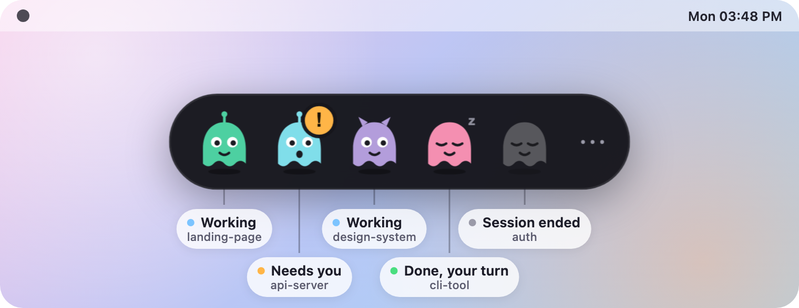
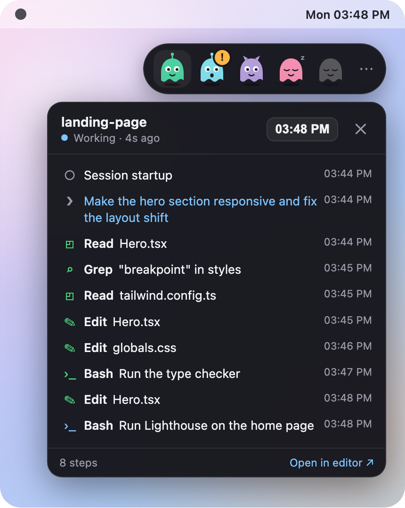
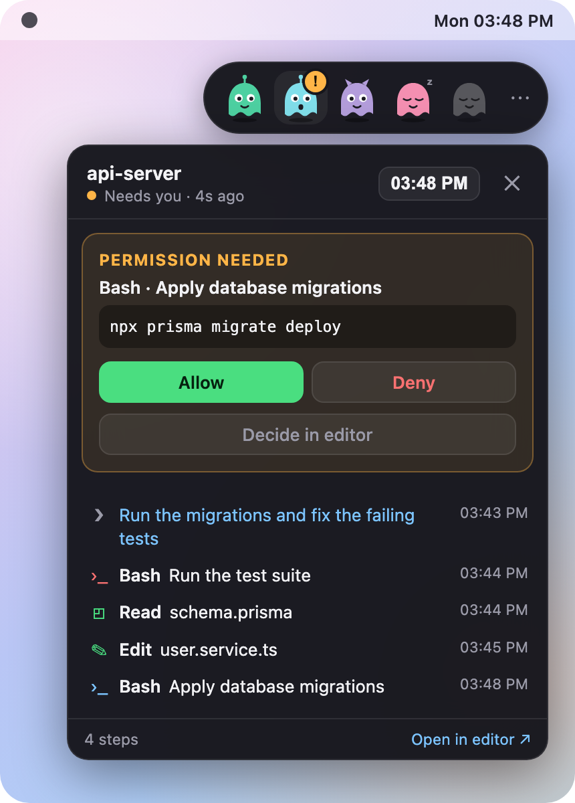
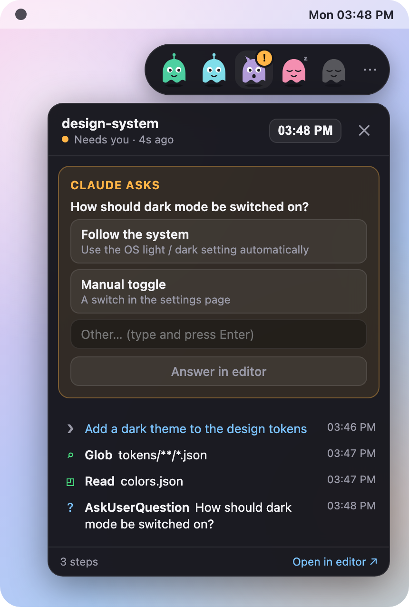
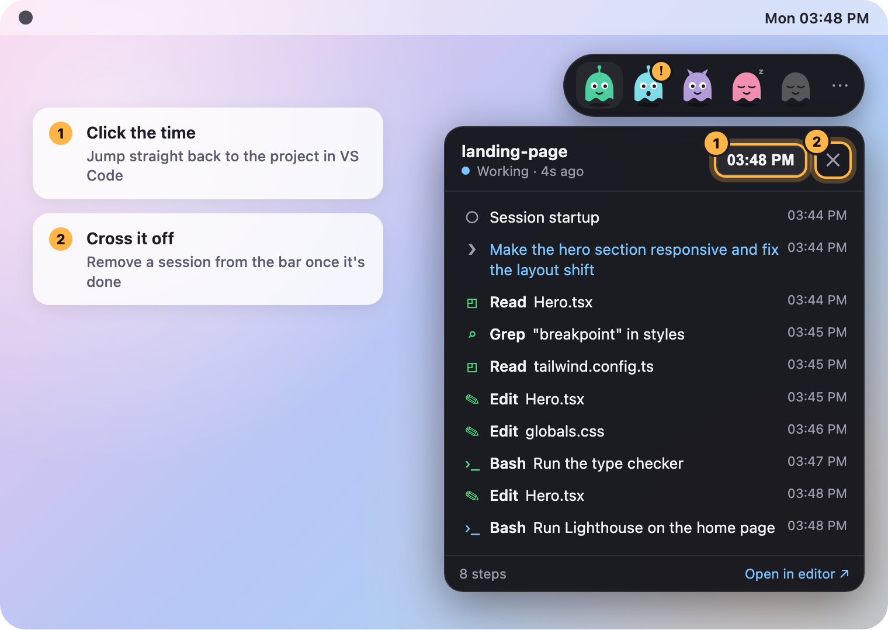

<div align="center">

# Buddybar

**A little bar of buddies in the corner of your screen, one for every Claude Code agent.**

See what your agents are doing, allow permissions and answer their questions without opening VS Code.




</div>

## Why

I'm starting a series where I show you tools I built for myself with Claude Code. This is the first one, and it fixes something that annoyed me every single day:

> When I minimize VS Code, I've got no idea what my agents are doing.

So I built **Buddybar**. It sits in the top-right corner of my screen and every agent gets its own little buddy. One look and I know who's working, who's waiting for me and who's done. No more opening and closing tabs all day.

It's open source and free for everyone, but first of all it's a tool I use myself, every day. If it saves you a few context switches too, great. Issues and PRs are welcome.

## Every agent gets a buddy

| Buddy | Means |
| --- | --- |
| Eyes open, bouncing | **Working** on your task |
| Hopping, orange `!` badge | **Needs you**: a permission or a question |
| Eyes closed, `z` | **Done**, waiting for your next prompt |
| Grey | **Session ended** |

Each session keeps the same color and look, so you quickly learn which buddy is which project.

## Features

<table>
<tr>
<td width="50%"></td>
<td>

### See every step

Click a buddy and the panel opens on that agent: your prompt, every file it reads or edits, every command it runs, and what it said when it finished. Running steps pulse, failed ones turn red.

</td>
</tr>
<tr>
<td width="50%"></td>
<td>

### Allow it right there

When an agent needs permission, its buddy starts hopping, the panel pops open and you get a system notification. You see the exact command and click **Allow** or **Deny**.

Rather decide in VS Code? *Decide in editor* hands it back to the normal prompt.

</td>
</tr>
<tr>
<td width="50%"></td>
<td>

### Answer its questions

When Claude asks you something, the options show up in the panel. Click one, or type your own answer under *Other…* and press Enter. The agent carries on right away.

</td>
</tr>
</table>

### Jump back or cross it off



Click the time to jump straight back to that project in VS Code (Cursor and Windsurf work too). Click the ✕ to cross off a session once it's done.

---

## Install

Requirements: **Node.js 18+** (Claude Code users already have it) and **Claude Code**.

```bash
git clone https://github.com/constPaolo/buddybar.git
cd buddybar
npm install
npm run hooks:install
npm start
```

`hooks:install` adds the Buddybar hooks to your Claude Code user settings (`~/.claude/settings.json`, or `%USERPROFILE%\.claude\settings.json` on Windows). Your existing hooks are kept and a backup is saved as `settings.json.buddybar.bak`. You can also install them from Buddybar's `⋯` menu.

Then start a new Claude Code session anywhere and a buddy will show up.

### Build a standalone app

```bash
npm run dist:mac   # .dmg + .zip in dist/
npm run dist:win   # installer + portable .exe in dist/
```

The builds are not code-signed, so the first time macOS / Windows SmartScreen will ask you to confirm.

### Try it without real agents

```bash
npm start
npm run demo   # in a second terminal
```

The demo spins up three fake agents: one working, one asking for permission and one asking a question.

## Usage

| Action | How |
| --- | --- |
| See what an agent is doing | Click its buddy |
| Allow / deny a permission | Buttons in the yellow card |
| Answer a question | Click an option, or type in *Other…* and press Enter |
| Give it back to the editor | *Decide in editor* / *Answer in editor* |
| Jump back to the project | Click the time in the panel header |
| Cross off a session | `✕` in the panel header |
| Menu (hooks, launch at login, quit) | `⋯` or right-click |
| Show / hide Buddybar | `Ctrl+Alt+Shift+H` (Windows) / `⌘⌥⇧H` (macOS) |
| Close the panel | `Esc` |

## How it works

```
 Claude Code (VS Code, Cursor, terminal…)
        │  hooks: SessionStart, PreToolUse, PermissionRequest, Stop…
        ▼
 ~/.buddybar/buddybar-hook.js   ── POST ──▶  Buddybar app (127.0.0.1:47821)
        ▲                                         │
        └──── your decision (allow / deny / answer) ◀── you click in Buddybar
```

Buddybar uses the official [Claude Code hooks](https://docs.claude.com/en/docs/claude-code/hooks). A tiny Node script runs on every hook event and forwards it to the app over localhost.

- **Activity** (prompts, tool calls, results, "done") is fire-and-forget, so your agents never slow down.
- **Permission requests** and **questions** (`AskUserQuestion`) wait for you in Buddybar. You can always hit *Decide in editor* to hand it back to the normal prompt.
- **If the app isn't running, the hook exits immediately** and Claude Code behaves exactly as before.

Everything stays on your machine. The local server only listens on `127.0.0.1` and every request needs a random token stored in `~/.buddybar/token`.

## Settings

`~/.buddybar/config.json` (created on first run, open it from the `⋯` menu):

```json
{
  "port": 47821,
  "editor": "vscode",
  "notifications": true,
  "waitSeconds": 300
}
```

- `editor`: what the time button opens: `vscode`, `vscode-insiders`, `cursor` or `windsurf`. It's auto-detected per session when possible; this is the fallback.
- `notifications`: system notification when an agent needs you.
- `waitSeconds`: how long a permission or question waits in Buddybar before it falls back to the normal prompt in your editor.

Restart the app after changing settings.

## Uninstall

```bash
npm run hooks:uninstall
```

Then delete the folder and `~/.buddybar`.

## Good to know

- **"Jump back"** opens the project folder in your editor (`vscode://file/...`), which focuses the window that has it open. Editors don't expose a way to focus one specific chat tab, so that part is still on you.
- While a permission is waiting in Buddybar, the editor won't show its own prompt. That's on purpose, so you don't get asked twice. Use *Decide in editor* if you'd rather answer there.
- Sessions that were already running before you installed the hooks won't show up. Start a new one.

## Roadmap

- [ ] "Always allow" for a tool, straight from Buddybar
- [ ] Drag Buddybar to any corner
- [ ] Token / cost per session
- [ ] Sound when an agent finishes

## Development

```bash
npm start      # run the app
npm test       # unit tests (node:test, no extra deps)
npm run screenshots   # re-render the README images in docs/images
```

```
src/main.js            Electron main process: window, menu, notifications
src/server.js          localhost bridge the hooks talk to
src/sessions.js        session state + translating your decisions for Claude Code
src/renderer/          Buddybar UI (vanilla JS, no framework)
hooks/buddybar-hook.js the hook Claude Code runs (zero dependencies)
scripts/hooks-setup.js install / uninstall the hooks
scripts/screenshots/   renders the README images from the real UI
```

## License

[MIT](LICENSE) © Paolo Meccariello
